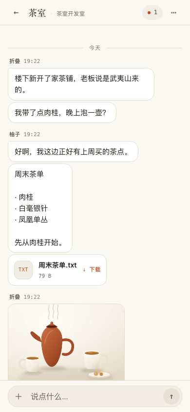
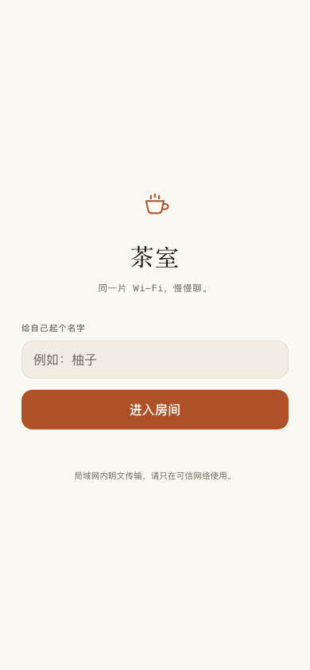
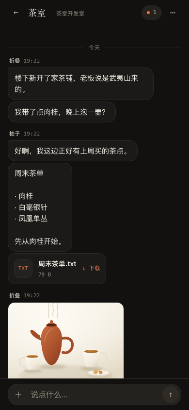

<div align="center">


<h1>茶室 · TeaTalk</h1>

<p><strong>同一片 Wi-Fi，慢慢聊。</strong></p>

<p>
一台安卓手机开房间，朋友自动发现、扫码或直接用浏览器加入。<br/>
不注册账号，不绕公网，不把聊天和文件传到云端。
</p>

<p>


</p>

<p>

&nbsp;&nbsp;

&nbsp;&nbsp;

</p>

<p><sub>截图均为 390×844 @1x，与仓库既有尺寸一致。</sub></p>

</div>

---

## 茶室是什么

**茶室**是一个“局域网优先”的小型聊天 + 文件传输工具。

它解决的是很具体的场景：几个人在同一个 Wi-Fi 下，想快速拉个群聊、发几张图或几个文件，但不想建群、加好友、注册账号，也不想让内容先绕一圈云服务器。

> 一间房，几个人。打开就能聊，关掉不留云。

## 能做什么

| | |
|---|---|
| 🫖 **一台手机就是主机** | 安卓手机点「开房间」，自动生成局域网地址和二维码。 |
| 🔎 **近邻自动发现** | 同 Wi-Fi 下的安卓加入端会自动列出附近茶室，不用每次扫码。 |
| 📷 **扫码 / 手动地址** | iPhone、电脑或其他设备可以扫主机二维码，或输入 `IP:端口` 加入。 |
| 💬 **聊天、发文件、看图** | 文字、文件上传下载、图片预览都在同一个页面。 |
| 🗂 **7 天文件库** | 右滑文件可延期 7 天；过期自动清理。 |
| ⬇️ **App 内下载** | 下载不走系统的下载服务，在页面里就能看进度、取消、打开文件。 |
| 🎨 **外观可调** | 首页「设置」里可以选跟随系统 / 浅色 / 深色。 |
| 🧹 **清除聊天，保留文件** | 清空聊天记录里的文字和文件卡片，文件仍留在「文件」里。 |
| 🔔 **后台继续开房** | 主机切到后台或锁屏后，前台服务会尽量保持房间在线；通知栏可回到房间。 |
| 📱 **Android + Web** | 主机和加入端都有 Android 原生界面；聊天页是共用的轻量 Web UI。 |

## 三步开聊

1. **一台安卓手机点「开房间」**  
   主机启动房间，屏幕上出现二维码和局域网地址。

2. **朋友加入**  
   安卓 App 会自动发现附近房间；iPhone / 电脑用浏览器扫码或输入地址即可。

3. **开始喝茶**  
   聊天、发文件、看图片。文件默认保留 7 天，右滑可延期。

## 适合谁

- 宿舍、合租屋、工作室里的日常群聊
- 咖啡馆、展会、临时活动的快速文件互传
- 不想把内部资料上传到第三方网盘的小团队
- 想给旧手机找一个“局域网小主机”用途的人

## 快速开始

### 从源码构建 Android App

需要 Android SDK 37 / build-tools 37.0.0。

```bash
git clone https://github.com/arkerniss/TeaTalk.git
cd TeaTalk
./gradlew :app:assembleDebug
```

构建完成后，把 `app/build/outputs/apk/debug/` 下的 APK 安装到安卓手机即可。

> 本项目的 GitHub Release 只维护更新日志，不附 APK；APK 请从本地构建产物获取。

### 本地调试 Web 聊天页

```bash
./gradlew :devserver:installDist
devserver/build/install/devserver/bin/devserver
# http://127.0.0.1:18520/
```

## 一些设计取舍

**为什么是局域网？**  
聊天和文件都在自己的 Wi-Fi 里走，速度取决于路由器，不经过公网。代价是：主机和加入设备必须在同一个网络，且目前没有端到端加密，适合可信网络。

**为什么还要原生 App？**  
因为 Android 可以做两件浏览器不擅长的事：局域网自动发现，以及开房后由前台服务继续维持房间。Web 负责让 iPhone、电脑和所有加入端不用装客户端。

**为什么文件有 7 天期限？**  
主机存储空间有限，文件库默认只保留最近 7 天；确实需要的文件可以右滑延期。清除聊天记录不会删文件，两个功能互不打扰。

**界面为什么长这样？**  
这套叫 Paper & Clay：暖纸色的底，衬线标题，一处陶土色做点睛，时间、IP、文件大小这些零碎信息用等宽字，分隔只靠一根发丝线。浅色和暗色跟着系统走，也能在首页「设置」里手动钉住。没有毛玻璃，也没有堆叠的入场动效——上一版动效被反馈过「觉得卡」，所以这次只留下颜色和按压反馈，把该省的省掉。

**为什么自己写下载器？**  
系统的下载服务会把用户甩到通知栏，回来还得自己找文件；而这里传的都是同一个小房间里的小文件，进度就该长在页面上。于是下载由 App 自己流式读取，存进「下载/茶室」，还在进程里跑——离开聊天页也不会断。

## 技术栈与结构

<details>
<summary>展开查看</summary>

- **Android**：Kotlin、Jetpack Compose、CameraX、ZXing
- **服务端**：内嵌 Ktor（HTTP + WebSocket）、纯 JVM `core` 模块
- **发现**：UDP 广播/探测，端口 `18522`；加入端用 MulticastLock
- **聊天页**：一份 `web/` UI，主机 WebView 与浏览器共用
- **保活**：前台服务 + `HostRuntime` 持有房间，`START_STICKY` 补偿
- **文件**：独立文件库索引，消息日志与文件生命周期解耦

```text
app/        Android 主机 / 加入 / 扫码 / WebView
core/       聊天引擎、文件库、Ktor 服务、UDP 发现
web/        共用 Web 聊天 UI
devserver/  本地浏览器调试服务器
docs/       截图、图标、发布说明
```

主要端口：房间 `8520`，发现 `18522`。

</details>

## 版本与更新

当前构建版本：**0.1.9.1**

- [更新日志](CHANGELOG.md)
- [Release 页面](https://github.com/arkerniss/TeaTalk/releases)

版本规则很简单：不构建 APK 的源码迭代只递增最后一位；真正构建时递增第三位。

## 边界

- 同一局域网、明文 HTTP，仅适合可信网络；没有 PIN / 端到端加密。
- 自动发现仅 Android 加入端支持；iPhone / 电脑使用扫码或手动地址。
- 主机开房依赖 Android 前台服务；厂商极端省电、强制停止仍可能中断房间。
- 文件保存在主机 App 私有目录，默认保留 7 天；卸载 App 会一起删除。

---

<div align="center">

**茶室 · TeaTalk**

*给近处的人，一间不用绕远路的房间。*

</div>
